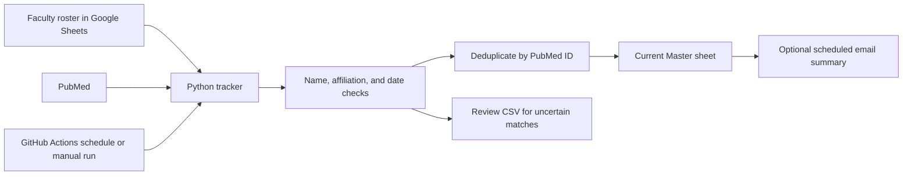

# PubMed Author Tracker

[](https://github.com/AnshVKapadia/pubmed-author-tracker/actions/workflows/ci.yml)

**Turn a faculty roster into a publication report, automatically.** This Python project searches PubMed, checks author identities and affiliations, and delivers a current publication list in Google Sheets. Configurable reporting periods and an optional email integration support recurring research summaries.

## Why I built it

Keeping track of a research group's publications means repeatedly searching names, checking affiliations, and removing duplicate papers. Names can be abbreviated, researchers can share a name, and several faculty members can coauthor the same paper. This tracker brings those tasks into a repeatable workflow that people can configure through a spreadsheet.

## At a glance

| Input | What the tracker does | Output |
| --- | --- | --- |
| Faculty names, aliases, and institutions | Searches PubMed and checks each person's affiliation | One Master sheet with unique publications |
| A quarter or custom date range | Filters by publication date | A report restricted to that period |
| A reporting interval | Checks when the next completed period is due | Automatic updates and optional email summaries |

**Technology:** Python · PubMed / NCBI E-utilities · Google Sheets API · GitHub Actions · Google Apps Script. Gemini themes are optional.

## How it works



Each run rebuilds Master for the chosen period. A shared paper appears once, while each confirmed tracked coauthor receives credit in faculty statistics. Uncertain matches are withheld for review. Older results can be rebuilt by searching a wider date range.

## Try it without a Google account

After installing Python dependencies using the instructions below, run this included example:

```bash
python src/script.py --config examples/Config.tsv --pubmed-xml tests/fixtures/pubmed.xml --quarter 2026-Q3 --dry-run
```

It uses synthetic faculty and saved PubMed XML, so it needs no credentials or network access. Open `out/master.csv` for accepted papers, `out/review.csv` for uncertain matches, and `out/analytics.json` for counts and reporting metadata.

## Engineering choices

- **Identity checks:** checks each person's own affiliation rather than assuming every author belongs to an institution mentioned on a paper.
- **Reproducible reports:** uses explicit date windows and deduplicates by PMID, PubMed's unique article identifier.
- **Safe publication:** previews by default, stops when collection is incomplete, and updates Sheets in one atomic batch after checking for concurrent edits.
- **Reliable collection:** paginates searches, splits oversized queries, limits request rates, and retries transient failures.
- **Adjustable automation:** daily checks detect when a reporting period is due; manual runs do not queue email.

CI runs 44 Python regression tests across Python 3.11 and 3.13, plus email checks using mocked Google services. These cover matching, dates, publishing, reporting intervals, and duplicate-email prevention.

## Scope and limitations

This is a publication-discovery tool, not a guarantee that every paper will be found. It depends on PubMed's coverage and metadata; ambiguous names, missing affiliations, and imprecise dates may require review. It keeps one current Master report rather than a permanent archive. Email delivery requires separate Apps Script authorization and recipient setup.

## Use it through GitHub

1. Edit your spreadsheet's **Config** tab to manage faculty, name aliases, and affiliations.
2. In the repository's **Actions** tab, open the workflow in `quarterly.yml` (now named **PubMed Update**).
3. Select **Run workflow** and choose the `main` branch.
4. Leave **Publish** unchecked to preview a run. Set **Report quarter** to `2026-Q3`, or leave it blank for the most recently completed reporting period. Leave Themes unchecked unless configured.
5. Inspect the run summary and collection log. A dry run does not change Google Sheets or queue email.
6. Check **Publish** only when ready to replace Master. The original Google credentials and spreadsheet ID remain supported.

To search a longer range, fill in Start date and End date instead of Report quarter. A run from `2020-01-01` to `2026-09-30`, for example, rebuilds Master for that entire range. It replaces the previous report; it does not append an archive.

## Automatic reports and email

In Config's `[SETTINGS]` section, set:

| Key | Value |
| --- | --- |
| `report_interval_months` | `3` for quarterly reports (the default) |

Supported intervals are `1`, `2`, `3`, `4`, `6`, and `12` calendar months, aligned from January. For example, quarterly periods are January–March, April–June, July–September, and October–December. Monthly periods are individual calendar months.

GitHub checks daily at 06:17 UTC. If the latest completed period has already been published, it stops without searching PubMed. Otherwise it collects that period, replaces Master, and queues an email summary. This allows a missed first-of-month run to catch up on a later day. It reports the latest completed period, not a backlog of every missed period.

The optional Apps Script clock trigger checks for a queued email once per hour. Configure the sending Google account and recipients using [apps-script/README.md](apps-script/README.md). **No email is sent until this integration is explicitly installed and enabled.** The period is controlled in Config; the hourly check is not an hourly email schedule.

Only automatic published reports queue new email. Manual runs and dry runs do not. Manual publications preserve any pending automatic email summary so a test cannot erase it. The email contains the automatic period's counts; its workbook link always opens the latest Master, which may reflect a subsequent manual run.

## Google setup

Keep your existing Config tab. The original three-column author layout is supported; [examples/Config.tsv](examples/Config.tsv) is a synthetic template. Separate aliases or institution keywords with `|`. An optional fourth author column can contain an ORCID.

Required GitHub Actions secrets (or local `.env` variables):

| Variable | Purpose |
| --- | --- |
| `SPREADSHEET_ID` | Target spreadsheet ID |
| `GOOGLE_APPLICATION_CREDENTIALS_JSON` | Existing service-account JSON |
| `NCBI_API_KEY` | Optional higher PubMed request limit |
| `GEMINI_API_KEY` | Optional AI themes |

Enable Google Sheets API in the service account's project and share the spreadsheet with that service account as **Editor**. Normal tracking needs only the Sheets API scope, not Drive API. Keep secrets out of Config, code, and chat. `.env.example` lists the supported variables.

The program manages only the **Config** and **Master** tabs. On publication, it removes generated History, History Backup, Summary, Quarterly Summary, Faculty Summary, Low Confidence Articles, and faculty-name tabs from the earlier design. Unrelated custom tabs are preserved. Unexpected columns, formulas, or unlabelled data in managed tabs stop the update rather than being discarded. A local pre-run snapshot is written before collection.

Config's `last_report_json` is machine-managed: it records the current report and the pending automatic email summary. `last_run_utc` is a successful-run marker, not a lower bound that pulls older records into Master. Do not edit these values routinely. No extra reporting worksheets are required.

## Date selection

- By default, Master contains only the last completed configured reporting period. On October 16 with interval `3`, that is July 1–September 30.
- `starting_date` and `ending_date` in Config override dates for manual runs. Clear them afterward. Automatic runs deliberately ignore these manual overrides.
- CLI `--start`/`--end` and workflow date inputs support arbitrary ranges. `--quarter YYYY-Qn` is a convenience shortcut; do not combine it with manual date overrides.
- PubMed searches publication dates, then the parsed publication date is checked again before inclusion. Records found outside the selected window are excluded even if an API search returns them.
- Journal issue dates are used, with electronic date fallback when no journal month is available. An imprecise year/month must fit entirely inside the selected range. Otherwise the record is omitted from Master and listed in the local review CSV.

For example, a paper published in June 2024 is excluded from a July–September 2026 report, even if a search happens to return it.

## Matching and counts

Master has one row per PMID. All confirmed tracked coauthors are listed in `tracked_author`; each person gets credit in the email's faculty statistics, while a shared paper counts once in the total.

The matcher checks the person's own affiliation. Full-name/ORCID evidence with an institutional match is accepted; initials-only, missing-affiliation, or mismatched-affiliation cases are withheld for review. Initials-only searches require an article-level institutional clue to avoid thousands of unrelated candidates. Full-name searches remain broader. Rule-based identity matching can still miss ambiguous publications.

Uncertain matches are available in the local `review.csv`; there is no persistent review/history worksheet or decision archive. Rebuilding reports later means searching PubMed again.

## Local testing

Use Python 3.11 or 3.13:

```bash
python -m venv .venv
# Windows: .venv\Scripts\activate
# macOS/Linux: source .venv/bin/activate
python -m pip install -r requirements.txt -c requirements.lock
python -m unittest discover -s tests -v
node tests/test_email.js
```

Run a complete offline example without credentials or network calls:

```bash
python src/script.py --config examples/Config.tsv --pubmed-xml tests/fixtures/pubmed.xml --quarter 2026-Q3 --dry-run
```

With Google credentials in `.env`:

```bash
python src/script.py --check-config
python src/script.py --quarter 2026-Q3 --dry-run
python src/script.py --quarter 2026-Q3 --publish
python src/script.py --start 2020-01-01 --end 2026-09-30 --dry-run
```

`out/` contains `master.csv`, `review.csv`, `analytics.json`, and a pre-run snapshot when Sheets is used. Old local files from an earlier version may remain in older output folders, but the program does not read them as history. Logs are in `logs/`. Publishing saved snapshots or offline fixtures is disabled.

## Reliability

The tracker paginates PubMed results, splits oversized queries, rate-limits calls, retries transient failures, and fetches shared PMIDs once. Incomplete collection stops before publishing. Master, automation metadata, the successful-run marker, and removal of obsolete generated tabs are applied in one atomic Sheets batch. Config and Master are rechecked before publication to catch concurrent edits.

If a write's outcome is uncertain, the tracker verifies the report marker rather than blindly replaying sheet creation/deletion. Inspect Config's `last_report_json` before retrying an uncertain publication. Avoid concurrent local publishers; GitHub runs are serialized.

GitHub CI tests Python 3.11 and 3.13 plus mocked email automation. Production report artifacts are opt-in using the repository variable `UPLOAD_REPORT_ARTIFACTS=true`; this repository is public, and snapshots may contain private spreadsheet data. Enabled artifacts expire after 30 days and are not a permanent history store.

[GitHub may disable public-repository schedules after 60 days of inactivity](https://docs.github.com/en/actions/how-tos/manage-workflow-runs/disable-and-enable-workflows), and schedules may be delayed. Check the Actions page periodically; an external scheduler is needed if that limitation is unacceptable.

## Optional AI themes

Install `requirements-ai.txt` with the lock constraints, set `themes_enabled=true` and a currently available `gemini_model` in Config, and provide `GEMINI_API_KEY`. `theme_max_papers` defaults to 100 when blank (maximum 500). `--themes` enables it for one manual run. Sampling and coverage are disclosed; a missing SDK, key, model, or provider failure does not stop publication tracking.

The old tracked `config/*.yaml` and journal CSV are unused historical files. The editable roster lives in the spreadsheet's Config tab.

